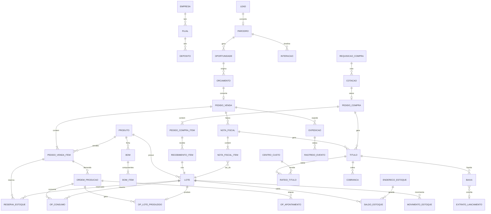

# MCK ERP — Arquitetura, DER, Máquina de Estados e Plano

## 1. Arquitetura

**Estilo:** monólito modular orientado a eventos, na mesma stack do MCKBOT (Node 22 + TypeScript, Express, Zod, React 18 + Vite, Prisma + PostgreSQL). Roda grátis no Render Free + Neon/Supabase. Cada módulo tem fronteira própria e só fala com outro por **eventos** ou por **serviço público**, nunca por tabela alheia. Assim, se um dia crescer, um módulo vira serviço separado sem reescrever.

```
web/src/erp/            React: Kanban (CRM, Pedidos, OP), telas, dashboards
server/erp/
  core/                 empresa, filial, centro de custo, plano de contas, numeração
  shared/
    events/             outbox + dispatcher + consumidores idempotentes
    audit/              audit_log (append-only) + trace_link (rastreio ponta a ponta)
    integrations/       hub de adaptadores + fila de retry
    statemachine/       motor genérico de estados (puro, testável)
  crm/ vendas/ estoque/ producao/ compras/ fiscal/ financeiro/ bi/
prisma/                 schema "erp" (multiSchema), separado do schema do MCKBOT
```

**Barramento de eventos sem custo (Transactional Outbox):**
1. O módulo grava a mudança **e** o evento (`domain_event`) na mesma transação. Nunca há pedido aprovado sem evento.
2. Um dispatcher lê com `FOR UPDATE SKIP LOCKED`, entrega aos consumidores e marca entregue.
3. Cada consumidor registra em `event_consumption (evento_id, consumidor)` com chave única = idempotência (reprocessar não duplica reserva nem título).
4. Falha → retentativa com backoff exponencial → após N tentativas, vai para a fila morta (DLQ) visível no painel, com botão "reprocessar".

**Fluxo-exemplo:** `PedidoAprovado` → Estoque tenta reservar → (falta) `NecessidadeGerada` → MRP explode BOM → `SugestaoOP` / `SugestaoCompra` → Financeiro grava provisão de recebimento.

**Rastreabilidade:**
- `correlation_id` nasce no lead/oportunidade e viaja por pedido → OP → NF → título → baixa.
- `trace_link (origem_tipo, origem_id, destino_tipo, destino_id, tipo_vinculo)` monta o grafo "do lead ao boleto pago e ao lote de matéria-prima".
- `audit_log` só de inserção: quem, quando, antes/depois (JSON), IP.
- Nada é apagado: cancelamento é estado + estorno.

**Multiempresa:** toda transação carrega `empresa_id`, `filial_id` e, onde couber, `centro_custo_id`, base dos filtros dos dashboards. Valores em `Decimal(15,2)`, quantidades em `Decimal(15,4)`.

**Integrações (adaptadores trocáveis):**
| Necessidade | Opção gratuita / observação |
|---|---|
| CNPJ (razão, endereço, CNAE, situação, Simples) | BrasilAPI / ReceitaWS: gratuito |
| Inscrição Estadual | Consulta CCC da SEFAZ exige certificado A1: fase fiscal |
| NF-e / NFS-e / DANFE | Precisa de certificado A1 + provedor (geralmente pago). Adaptador pronto, com modo homologação |
| Boleto, Pix dinâmico, link | Via banco/gateway (cobram tarifa por título). Reaproveita boletos e régua do MCK Mensagens |
| Frete e etiqueta | Melhor Envio (conta grátis, paga por etiqueta) |
| WhatsApp / e-mail | Reaproveita MCKBOT (QR/Cloud API) e Brevo |
| Conciliação | OFX grátis; Open Finance depois |

## 2. DER (núcleo de integridade)



**Tabelas por módulo**
- **Core:** empresa, filial, centro_custo, plano_conta (DRE), usuario (reusa auth/RBAC do MCKBOT), alcada (limites de desconto/compra/crédito por papel), sequencia_documento.
- **CRM:** parceiro (cliente e fornecedor unificados, CPF/CNPJ único por empresa, IE, regime, CNAE, situação Receita, score, limite_credito), parceiro_endereco, parceiro_contato, lead, oportunidade (etapa Kanban, valor, probabilidade, origem, custo de aquisição), interacao (tipo: whatsapp, email, ligação, chamado; vínculo com mensagem do MCKBOT), chamado.
- **Produtos e preços:** produto (NCM, CEST, origem, unidade, peso, cubagem, controla_lote, regra FEFO/FIFO, ponto_pedido, estoque_min, custo_medio, custo_padrao), tabela_preco (região/UF, volume), tabela_preco_item, condicao_pagamento (parcelas, prazos).
- **Estoque/WMS:** deposito, endereco_estoque (rua/prateleira/posição, QR), lote (nº, fabricação, validade, status: liberado/quarentena/bloqueado, origem: compra ou OP), saldo_estoque (produto+lote+endereço, físico, reservado, quarentena; disponível = físico − reservado − quarentena; CHECK ≥ 0), movimento_estoque (razão imutável: tipo, qtd, custo, documento_origem_tipo/id), reserva_estoque, inventario, inventario_contagem.
- **Vendas/OMS:** orcamento, orcamento_item, pedido_venda (status_operacional, status_financeiro, correlation_id), pedido_venda_item, aprovacao (alçada), separacao (picking sugerido por FEFO), separacao_item (lote lido no QR), expedicao (transportadora, frete cotado, etiqueta, rastreio), volume, rastreio_evento.
- **Produção/MRP:** bom (versão, vigência), bom_item (multinível via produto componente com BOM própria, perda %), roteiro, roteiro_operacao (recurso, setup, tempo padrão), recurso (máquina/centro de trabalho), mrp_execucao, mrp_sugestao (produzir/comprar, qtd, data), ordem_producao (QR), op_consumo (lote real de insumo), op_apontamento (início/fim, paradas, refugo), op_lote_produzido.
- **Compras:** requisicao_compra (origem: ponto de pedido, MRP, manual), cotacao, cotacao_fornecedor, cotacao_item (mapa comparativo), pedido_compra, pedido_compra_item, recebimento (conferência cega), recebimento_item, nfe_entrada_xml (manifesto SEFAZ).
- **Fiscal:** regra_tributaria (NCM × CFOP × UF origem/destino × regime → ICMS, ST, IPI, PIS, COFINS, ISS), nota_fiscal (entrada/saída, chave, status SEFAZ, XML, PDF), nota_fiscal_item (impostos calculados, lote), evento_fiscal (cancelamento, CC-e).
- **Financeiro:** titulo (pagar/receber, parcela, vencimento, valor, saldo, origem NF/pedido/compra), rateio_titulo (centro de custo × plano de contas), cobranca (boleto, Pix, link; nosso número, txid), regua_cobranca, baixa (total/parcial, juros, desconto, estorno), conta_bancaria, extrato_lancamento (OFX/API), conciliacao.
- **Plataforma:** domain_event, event_consumption, integration_job (retry/DLQ), audit_log, trace_link, mensagem_canal (abertura de e-mail, leitura no WhatsApp).

**Regras de integridade que o banco garante:**
- Saldo nunca negativo (CHECK) e toda mudança de saldo passa por movimento_estoque na mesma transação.
- Item de NF de saída aponta para o lote que saiu; o lote produzido aponta para a OP e a OP para os lotes consumidos (genealogia completa para recall).
- Título só nasce de documento de origem (NF, pedido de compra) ou lançamento manual auditado.
- FKs com `ON DELETE RESTRICT`; documentos fiscais e financeiros nunca são excluídos.

## 3. Máquina de Estados do Pedido de Venda

Duas regiões paralelas: **operacional** e **financeira**. O pedido só fica **CONCLUÍDO** quando está ENTREGUE **e** LIQUIDADO.

**Operacional**
| De | Evento / guarda | Para | Efeitos (eventos emitidos) |
|---|---|---|---|
| RASCUNHO | enviar | EM_APROVACAO | — |
| EM_APROVACAO | desconto acima da alçada ou crédito insuficiente | BLOQUEADO | notifica aprovador |
| BLOQUEADO | aprovado pelo gestor / crédito liberado | APROVADO | — |
| EM_APROVACAO | dentro das regras | APROVADO | `PedidoAprovado` → reserva + provisão financeira |
| APROVADO | estoque disponível | RESERVADO | `EstoqueReservado` |
| APROVADO | falta item | AGUARDANDO_SUPRIMENTO | `NecessidadeGerada` → MRP: OP e/ou compra |
| AGUARDANDO_SUPRIMENTO | OP concluída / compra recebida | RESERVADO | — |
| RESERVADO | liberar separação | EM_SEPARACAO | picking por FEFO/FIFO |
| EM_SEPARACAO | conferência QR ok | SEPARADO | — |
| SEPARADO | NF autorizada | FATURADO | `PedidoFaturado` → títulos a receber, envio DANFE/XML |
| FATURADO | etiqueta + coleta | EM_TRANSPORTE | rastreio |
| EM_TRANSPORTE | confirmação de entrega | ENTREGUE | OTIF calculado |
| EM_TRANSPORTE | entrega parcial / recusa | ENTREGA_PARCIAL / DEVOLVIDO | devolução, NF de entrada |
| qualquer antes de FATURADO | cancelar | CANCELADO | libera reservas, estorna provisão |
| FATURADO+ | cancelar NF (prazo legal) | SEPARADO | estorna títulos |

**Financeira:** SEM_TITULO → PROVISIONADO (aprovado) → EM_ABERTO (faturado) → PARCIAL → LIQUIDADO; ou EM_ABERTO → VENCIDO → INADIMPLENTE (régua de cobrança), voltando a LIQUIDADO com a baixa.

Toda transição passa pelo motor de estados (função pura `transition(estado, evento, contexto)`), grava `audit_log` e emite o evento no outbox.

## 4. Plano em 5 etapas

1. **Fundação + CRM (Módulo 1):** core multiempresa, outbox/eventos, auditoria e trace, motor de estados; cadastro 360º com CNPJ via BrasilAPI; funil Kanban; timeline com WhatsApp e e-mail reaproveitando o MCKBOT; limite de crédito e score; KPIs (ativos/inativos, CAC, ticket médio, conversão, inadimplência).
2. **Produtos, Estoque/WMS e Vendas/OMS:** produtos, tabelas de preço, alçadas; saldos físico/reservado/quarentena/disponível; lotes com FEFO/FIFO; endereçamento e etiquetas QR; orçamento → pedido com a máquina de estados; separação e conferência por QR.
3. **Compras e Produção/MRP:** ponto de pedido, requisição, mapa de cotação, pedido de compra, recebimento cego, custo médio; BOM multinível, roteiros, MRP, OP com QR, apontamento, consumo de lote, refugo, OEE.
4. **Fiscal e Financeiro:** motor tributário, NF-e/NFS-e por adaptador (homologação primeiro), títulos automáticos, rateio por centro de custo, DRE gerencial, boleto/Pix/link via gateway, régua de cobrança (reaproveita MCK Mensagens), conciliação OFX, fluxo de caixa previsto × realizado.
5. **Hub de integrações, Logística e BI:** frete e etiquetas, rastreio, monitor de engajamento, dashboard executivo com filtros por período, filial e centro de custo, rastreio visual ponta a ponta; endurecimento e desempenho.

**Testes enxutos:** só testes unitários das regras críticas (motor de estados, saldo/reserva, MRP, impostos) e a suíte existente rodada uma vez antes de cada commit, como manda a ATA. Sem e2e a cada etapa.

## Decisão 2026-11-03 (Mayck): fiscal configurado pelo cliente
- O ERP não contrata provedor fiscal. Cada empresa cliente conecta a própria SEFAZ num assistente simples "Conectar SEFAZ":
  1. Envia o certificado A1 (.pfx) e a senha (guardados cifrados, por empresa).
  2. Informa UF, CNPJ, IE, regime, série e próximo número da NF-e (CNPJ preenche o resto via BrasilAPI).
  3. Escolhe homologação ou produção; botão "Testar conexão" consulta o status do serviço da SEFAZ.
- Emissão direta nos webservices da SEFAZ com o certificado do cliente (sem custo para a MCK). NFS-e pelo padrão nacional, com adaptador para prefeituras fora dele.
- Opcional: campo para o cliente usar um provedor próprio (token), se preferir.
- O mesmo vale para boleto/Pix: o cliente informa as credenciais do banco/gateway dele.


## Etapa 1 entregue (2026-11-03): Fundação + CRM
- Backend em `server/erp/`: `shared/` (motor de estados, outbox de eventos com retry e fila morta, rastreio, auditoria), `core/` (filiais, centros de custo, monitor de eventos, rastreio), `crm/` (cadastro 360º com CNPJ via BrasilAPI, funil Kanban com máquina de estados, linha do tempo com envio real por WhatsApp/e-mail, KPIs).
- API: `/api/erp/core/*`, `/api/erp/crm/parceiros`, `/api/erp/crm/funil`, `/api/erp/crm/interacoes`, `/api/erp/crm/kpis`. Módulo de permissão `erp_crm`.
- Tela: menu "MCK ERP · CRM" (`/erp`, `/erp/funil`, `/erp/clientes`, `/erp/clientes/:id`) em `web/src/erp/`.
- Banco: migração `0038_erp_crm` só aditiva (tabelas `Erp*`).
- Testes: `tests/unit/erp-crm.test.ts` (estados, KPIs, CNPJ, backoff).

## Etapa 2 entregue (2026-11-03): Produtos, Estoque/WMS, Vendas/OMS
- `server/erp/produtos/`: produtos (NCM, CEST, origem, lote/validade, FIFO/FEFO, mínimo e ponto de pedido, custo médio), tabelas de preço regionais com faixa de volume, condições de pagamento, regras comerciais (alçada de desconto, bloqueio por crédito, validade do orçamento).
- `server/erp/estoque/`: depósitos e endereços (grade rua-prateleira-posição), lotes com quarentena, saldo físico/reservado/quarentena/disponível, razão imutável de movimentos, entrada/baixa/transferência, etiquetas QR (endereço e lote). Reserva por UPDATE atômico condicionado ao disponível; CHECK no Postgres impede saldo negativo.
- `server/erp/vendas/`: orçamento → pedido com a máquina de estados (seção 3), aprovação automática ou por gestor, reserva FEFO/FIFO, aguardando suprimento (evento `estoque.necessidade` para Compras/MRP), lista de separação por endereço, conferência por QR que só aceita o lote reservado, faturamento (NF externa até a Etapa 4) com baixa do estoque, expedição, entrega, devolução, cancelamento com liberação de reservas. Pedido aprovado fecha a oportunidade de origem como ganha e entra na linha do tempo do cliente.
- Telas: `/erp/produtos`, `/erp/estoque`, `/erp/pedidos`, `/erp/pedidos/:id`.
- Banco: migração `0039_erp_estoque_vendas` (só aditiva).
- Testes: `tests/unit/erp-estoque-vendas.test.ts` e `tests/integration/erp-estoque-vendas.test.ts` (FEFO, conferência, baixa, falta, alçada).

## Estoque completo (2026-11-03): entrada por XML, lotes, etiquetas e inventário
- **Entrada por XML de NF-e** (`server/erp/estoque/nfe-xml.ts`, `nfe.routes.ts`): lê o XML (modelo 55, layout 4.00) sem dependência externa; recusa duplicada pela chave; avisa se não há protocolo de autorização; cadastra o fornecedor pelo emitente; vincula itens por de-para do fornecedor (com fator de conversão, ex.: 1 CX = 12 UN) ou EAN; permite criar o produto a partir do item. Custo de entrada = produto + IPI + ST + frete + seguro + outras − desconto, rateado pela quantidade convertida (custo médio).
- **Lotes**: o lançamento gera lote interno no formato configurável (`{AA}{MM}{DD}-{SEQ}`, `{SKU}`…) guardando o lote do fornecedor (rastro da NF-e ou informado na conferência), o fornecedor e a nota de origem (trace nfe → lote). Opção de usar o lote do fornecedor como interno. Entrada em quarentena opcional.
- **Etiquetas** (`etiquetas.ts`, `web/src/erp/estoque/impressao.ts`): QR com o lote; ZPL II para Zebra (203/300 dpi, tamanho em mm, cópias) enviado pelo Zebra Browser Print local ou baixado como .zpl; impressora comum em folha A4 ou rolo. A CSP libera só `http://localhost:9100` para o Browser Print.
- **Inventário** (`inventario.routes.ts`): foto do saldo, contagem por leitura de endereço + lote/SKU, contagem cega, item achado fora da foto, envio para aprovação, recontagem e ajuste (contado − foto) como movimento INVENTARIO.
- Migração `0040_erp_nfe_entrada_lotes_inventario` (só aditiva).
- Fica para a Etapa 4 (precisa do certificado A1 do cliente): baixar as NF-e destinadas direto da SEFAZ (Distribuição DF-e) e manifestar o destinatário.

## Etapa 3 — Compras e Produção/MRP (2026-11-03)

**Compras** (`/api/erp/compras`, tela `/erp/compras`)
- Solicitação de compra com aprovação (só OWNER/ADMIN aprova). O MRP também cria solicitações (origem `MRP`).
- Cotação com vários fornecedores convidados; propostas lançadas por item (preço, prazo, condição). Mapa escolhe a melhor por item (menor preço; empate → menor prazo), o comprador pode trocar. Encerrar gera um pedido de compra por fornecedor vencedor e baixa o atendido da solicitação.
- Pedido de compra com máquina de estados (RASCUNHO → EM_APROVACAO → APROVADO → ENVIADO → RECEBIDO_PARCIAL/RECEBIDO; CANCELADO). Alçada (`ErpConfig.alcadaCompraCents`, padrão R$ 5.000): até ela, aprova ao enviar; acima, só OWNER/ADMIN. Impressão/PDF para o fornecedor.
- Recebimento: a NF-e de entrada se liga a um pedido aberto do mesmo fornecedor. No lançamento há confronto de quantidade (pendente) e preço (`toleranciaPrecoBp`, padrão 2%) e da conferência física. Divergência trava; só OWNER/ADMIN aceita. Recebimento cego opcional (`recebimentoCego`): o conferente não vê a quantidade da nota.

**Produção** (`/api/erp/producao`, tela `/erp/producao`)
- Estrutura (BOM) multinível com perda %, sem ciclos; roteiro com centro de trabalho, segundos por unidade, setup e custo/hora. Custo padrão = materiais (custo médio, multinível) + operações.
- Ordem de produção: PLANEJADA → LIBERADA (reserva FEFO/FIFO dos componentes; trava se faltar) → EM_PRODUCAO → ENCERRADA; CANCELADA. Reservas usam `ErpReserva` com `origemTipo = 'op'`.
- Apontamento: consumo por backflush na proporção do produzido + refugo, entrada do produto com lote interno ao custo real (materiais + operações + setup no 1º apontamento) e genealogia no trace (`lote compoe lote`, `op produziu lote`).
- MRP de período único (sem baldes de tempo): demanda dos pedidos de venda abertos + dependente das OPs + alvo (máx. de estoque mínimo e ponto de pedido) − disponível − a receber (pedidos de compra, OPs, solicitações). Processa por nível mais baixo, aplica lote mínimo, explode a estrutura. Aplicar gera OPs planejadas e uma solicitação de compra.
- Produto ganhou `leadTimeDias`, `loteMinimoMil`, `fornecedorPadraoId`.

**Migração** `0041_erp_compras_producao`: só aditiva. Não aplicada em Postgres de produção.

**Limitações conhecidas**: MRP sem baldes de tempo (datas só informativas); sem apontamento por operação nem capacidade finita; envio do pedido de compra/cotação ao fornecedor é por texto/PDF (sem e-mail automático).

## Etapa 4 — Financeiro e Fiscal (2026-11-03)

**Financeiro** (`/api/erp/financeiro`, tela `/erp/financeiro`)
- Contas (banco, caixa, cartão) com saldo inicial e chave Pix; saldo = inicial + lançamentos.
- Plano de contas gerencial por grupo da DRE (receita bruta, deduções, custos, operacionais, financeiras, impostos), criado com um padrão editável.
- Títulos a receber e a pagar com parcelas. Gerados por evento: `vendas.pedido.faturado` → a receber pela condição de pagamento; `estoque.nfe_entrada.lancada` → a pagar pelas duplicatas da nota (sem duplicata: uma parcela na emissão). Pedido cancelado/devolvido cancela os títulos sem baixa.
- Baixa total ou parcial com juros/multa e desconto (multa até 2% e juros de mora pro rata, configuráveis), estorno (só gestor), cancelamento (só gestor, sem baixa). Status financeiro do pedido acompanha (EM_ABERTO, PARCIAL, LIQUIDADO).
- Pix copia-e-cola (BR Code estático com CRC16) na chave do cliente, sem provedor.
- Transferência entre contas, lançamento avulso, importação de extrato OFX e conciliação (mesmo valor, até 3 dias; cria lançamento para tarifa).
- Painel: saldo, aging a receber e a pagar, fluxo de caixa projetado. DRE por competência ou caixa.

**Fiscal** (`/api/erp/fiscal`, tela `/erp/fiscal` e bloco "Nota fiscal" no pedido)
- Emitente, regime (Simples ou normal), ambiente (homologação padrão), série e numeração.
- Certificado A1 do próprio cliente, cifrado com `MASTER_KEY`; valida senha, validade e CNPJ.
- Regras de tributação por produto, por prefixo de NCM ou padrão: CFOP dentro/fora do estado, CSOSN/CST ICMS, IPI, PIS e COFINS.
- NF-e 4.00 a partir do pedido separado: chave com DV módulo 11, desconto e frete rateados, tributos por regra, XML assinado (XML-DSig, C14N, RSA-SHA1). Transmissão síncrona, nfeProc com protocolo, cancelamento em até 24 h (evento 110111), status do serviço, refazer após rejeição com o mesmo número, XML e DANFE com código de barras.
- Endpoints: SP e UFs da SVRS. Demais UFs com SEFAZ própria (MG, PR, RS, BA, GO, MS, MT, PE, AM, MA) ainda não.

**Migração** `0042_erp_financeiro_fiscal`: só aditiva. Não aplicada em Postgres de produção.

**Limitações conhecidas**: transmissão nunca testada contra a SEFAZ real (precisa do certificado do cliente; começar em homologação); sem ST, DIFAL, FCP, NFC-e, NFS-e, inutilização de numeração, carta de correção e download de DF-e; boleto registrado depende do banco do cliente (hoje: Pix copia-e-cola).

## Etapa 5 — BI (2026-11-03)
- `/api/erp/bi/resumo?de&ate` (tela `/erp/bi`): receita, CMV, margem bruta, ticket médio, receita por dia, maiores clientes, curva ABC com margem por produto; valor do estoque, cobertura em dias, itens abaixo do mínimo, lotes vencendo em 30 dias; compras por fornecedor; OPs encerradas, refugo e custo; inadimplência e a pagar em 7 dias; pipeline e conversão do CRM.
- Venda conta na data da baixa de estoque do faturamento; margem pelo custo médio dessa baixa. Pedidos cancelados ou devolvidos ficam fora.
- `/api/erp/bi/exportar?tipo=pedidos|produtos` em CSV (separador `;`, abre direto no Excel).
- Migração `0043_erp_bi` (coluna `encerradaEm` na OP). Não aplicada em produção.
- Limitação: cálculo na hora, sem cubo/pré-agregação; períodos até 400 dias.

## Ajustes pós-lançamento (2026-11-03, pedidos do Mayck)
- **Clientes e Fornecedores separados**: duas telas e dois formulários (`/erp/clientes`, `/erp/fornecedores`). Mesma tabela `ErpParceiro` por baixo (NF-e, pedidos e financeiro seguem ligados); cadastrar um CNPJ já existente no outro papel só acrescenta o papel.
- **Contas a pagar**: campo `natureza` no título — Fornecedor ou Conta da empresa (água, luz, internet, telefone, aluguel, imposto, outra). Filtro na aba A pagar; categoria do plano de contas preenchida pelo tipo quando vazia. NF-e de entrada = Fornecedor.
- **Alertas por WhatsApp** (`/erp/alertas`, só Proprietário/Admin): um resumo por dia, na hora escolhida, para até 5 números: contas a pagar vencidas e a vencer em N dias (fornecedores e contas da empresa separados), produtos abaixo do estoque mínimo e produtos com saldo sem saída há N dias (padrão 15). Envia por um WhatsApp conectado da organização (`sendToStaffNumber`); prévia e envio de teste na tela. Tick a cada 5 min com `ENABLE_SCHEDULER=true`; um envio por dia (reserva atômica de `alertaUltimoDia`).
- **Produto**: código de barras interno gerado no cadastro quando vazio (EAN-13 prefixo 2, uso interno GS1); campo de custo e lista "+ Adicionar custo" (embalagem, rótulo...) em `custosAdicionais`; custo total = custo + adicionais. Fornecedor padrão com seletor. "Ponto de pedido" aparece na tela como "Estimativa de compra".
- **Etiqueta do lote**: QR `MCK1;lote interno;lote do fornecedor;validade;SKU;descrição` + Code 128 do lote interno (ZPL e folha comum). A conferência aceita o QR novo e o código simples.
- Migração `0044_erp_alertas` (aditiva).
- **Venda balcão** (botão em Pedidos, `POST /api/erp/vendas/balcao`): leitor de código de barras ou busca, cliente opcional ("Consumidor final", documento 00000000000), Dinheiro/Pix/Cartão com troco. Numa transação: pedido → aprovado → reservado → separado → faturado (`BALCAO-n`) → entregue (nova transição FATURADO→ENTREGUE, retirada no local), baixa de estoque FEFO/FIFO, título a receber criado e liquidado na conta (cria "Caixa" se não houver). Sem estoque: nada é gravado.
- **Planilhas** (`/api/erp/io/:entidade/{modelo|exportar|importar}`, entidades clientes, fornecedores, produtos): modelo CSV com cabeçalho e exemplos (`;`, UTF-8 com BOM; aceita `,` e Windows-1252). Importar mostra prévia (`?simular=1`) com erro por linha antes de gravar; atualiza pela chave (CPF/CNPJ ou SKU) só as colunas preenchidas. Produtos ligam o fornecedor padrão pelo CNPJ. Botões Exportar/Importar nas telas de Clientes, Fornecedores e Produtos. Regra para as próximas etapas: todo cadastro novo ganha modelo, importação e exportação.
- **Menu lateral** em categorias recolhíveis: MCK ERP, MCKBOT, MCK Mensagens no topo; depois Gestão, Conta, Plataforma.
- **Plano Completo** (antigo Combo): ERP + MCKBOT + MCK Mensagens; preço padrão R$ 100/mês (R$ 1.000/ano). Em produção o preço vale o que está em Painel Master → Configurações (a linha já gravada não muda sozinha).
- **Custos extras entram no CMV**: saídas, consumo de produção e venda usam custo médio + custos adicionais (`custoTotal`). Valor do estoque segue no custo médio.
- **Custo vindo de NF-e (XML)**: alterar exige a senha do usuário (`senhaCusto`), fica no log (`erp.produto.custo_xml`, antes/depois/quem) e avisa o proprietário por WhatsApp (celular dele; sem ele, números de alerta) e e-mail. Planilha não altera esse custo.
- **Relatórios** (`/erp/relatorios`): relatório do dia (vendido, balcão, recebido/pago por forma, CMV, alterações sensíveis), CSV e "Enviar agora". Às 22h (fuso da empresa) vai sozinho ao proprietário (WhatsApp + e-mail com CSV), se houve movimento. Depende de `ENABLE_SCHEDULER=true`.
- **Funcionários** (`/erp/funcionarios`): convite pela Equipe com áreas do ERP: acesso (clientes/fornecedores/CRM), vendas, estoque, compras/produção, financeiro/fiscal, relatórios. Quem tinha só o acesso antigo continua vendo tudo.

## IA consulta o estoque do ERP (v1.24.0, 2026-11-08)
- `AiSettings.productSource` por empresa: `catalogo` (padrão, só Produtos), `erp` (só produtos ativos do ERP, sem INSUMO) ou `ambos` (Produtos para descrição/promoção/link + ERP para o saldo; liga pelo SKU citado no nome/detalhes do produto ou pelo nome igual). `erpShowQuantity` (padrão falso: só "disponível / poucas unidades / sem estoque / sob encomenda") e `erpDepositoId` (nulo = todos).
- Disponível = Σ (físico − reservado − quarentena) dos lotes LIBERADOS e não vencidos, reaproveitando `saldosParaSaida` + `planejarAlocacao` (mesma regra da reserva). Preço = `precoBaseCents` (o ERP não tem tabela padrão; 0 = "preço não cadastrado"). "Poucas unidades" = até 5 un. ou até o estoque mínimo. Produzido sem saldo = sob encomenda; serviço = disponível.
- Código: `server/ai/productSource.ts` (seleciona só campos públicos do ErpProduto: nunca custo, custos adicionais ou fornecedor); prompt em `server/ai/service.ts`; rotas `GET/PUT /api/ai/products/source` e `POST /api/ai/products/preview` (aceita a fonte escolhida na tela). Tela: Produtos › "De onde a IA consulta os produtos".
- Acesso: ERP só com Plano Completo ativo/teste ou empresa da MCK (`isMckOrg`); sem isso ou com erro no ERP, volta ao catálogo. Migração `0050_ia_fonte_produtos` (só aditiva).

## Caixa do PDV (abrir e fechar caixa) — 2026-11-08
- **Pedido do Mayck:** venda balcão só com caixa aberto, para saber quando abriu, com quanto dinheiro e quando fechou.
- **Regra:** `POST /api/erp/vendas/balcao` sem caixa aberto responde **409 "Abra o caixa antes de vender"** e nada é gravado. Orçamentos e pedidos normais não dependem do caixa. Vendas antigas ficam como estão (`caixaSessaoId` nulo).
- **Sessão** (`ErpCaixaSessao`): conta financeira do tipo CAIXA, quem abriu, quando, dinheiro na abertura (obrigatório, pode ser 0), observação; no fechamento: quem, quando, dinheiro contado, esperado, diferença (sobra/falta), totais por forma (JSON), sangrias, suprimentos e observação. Uma sessão aberta por conta CAIXA (coluna única `contaAberta`, nula depois de fechar). Empresa com várias contas CAIXA pode ter vários caixas abertos; aí a venda informa `caixaSessaoId` (a tela mostra "Caixa da venda"); sem ele vale a única aberta ou a aberta pelo próprio usuário.
- **Venda:** pedido e recebimento (`ErpPedidoVenda.caixaSessaoId`, `ErpBaixa.caixaSessaoId`) ficam ligados à sessão. Dinheiro vai para a conta do caixa aberto; Pix e cartão seguem a conta escolhida (como antes). A venda trava a linha da sessão na transação: fechamento e venda não se cruzam.
- **Sangria/suprimento** (`ErpCaixaMovimento`): valor, motivo obrigatório, quem e quando. Lançam na conta do caixa (`origemTipo` `caixa_sangria`/`caixa_suprimento`, fora da DRE) e, se escolhida, a contrapartida em outra conta (cofre/banco). Sangria maior que o dinheiro esperado é recusada.
- **Fechamento:** esperado em dinheiro = abertura + vendas em dinheiro + suprimentos − sangrias (estornos de baixa saem da conta); diferença = contado − esperado; diferença ≠ 0 exige observação. Depois de fechado, os valores ficam congelados e nenhuma venda balcão sai até abrir de novo. A diferença não gera lançamento automático (só informa). O dinheiro de abertura também não é lançado (é o troco que já estava na gaveta).
- **API** (`/api/erp/vendas/caixa`, área `erp_vendas`; leitura também para `erp_financeiro` e `erp_relatorios`): `GET /` (contas CAIXA, sessões abertas com resumo, sessão padrão do usuário), `POST /abrir`, `GET /sessoes?de&ate&status&contaId` (data de abertura no fuso da empresa), `GET /sessoes/:id` (relatório: resumo, sangrias/suprimentos, vendas), `POST /sessoes/:id/movimentos`, `POST /sessoes/:id/fechar`. Auditoria: `erp.caixa.abrir`, `erp.caixa.sangria`, `erp.caixa.suprimento`, `erp.caixa.fechar`.
- **Telas:** Venda balcão (PDV) mostra a faixa "Caixa aberto desde HH:MM por Fulano — R$ X na abertura" com Sangria, Suprimento e Fechar caixa; caixa fechado → o botão "Venda balcão" abre "Abrir caixa" primeiro. Aba "Caixas" com o histórico (filtro de datas e situação) e relatório imprimível em `/erp/caixa/:id`. Horários no fuso da empresa (padrão America/Sao_Paulo).
- **Código:** `server/erp/vendas/caixa.routes.ts`, `caixa.calculo.ts` (contas puras), `balcao.routes.ts`; `web/src/erp/vendas/Caixa.tsx`, `Pedidos.tsx`, `Balcao.tsx`.
- **Migração** `0052_erp_caixa` (só aditiva: 2 tabelas novas + coluna `caixaSessaoId` em ErpPedidoVenda e ErpBaixa). Aplica no deploy normal.
- **Testes:** `tests/unit/erp-caixa.test.ts`, `tests/integration/erp-caixa.test.ts`; `erp-balcao-importacao` abre o caixa antes de vender; e2e `erp-balcao.spec.ts` abre o caixa na tela.
