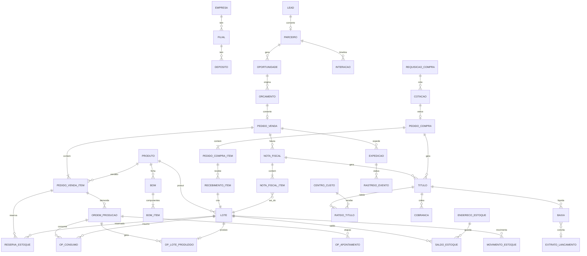

# MCK ERP — Arquitetura, DER, Máquina de Estados e Plano

## 1. Arquitetura

**Estilo:** monólito modular orientado a eventos, na mesma stack do MCKBOT (Node 22 + TypeScript, Express, Zod, React 18 + Vite, Prisma + PostgreSQL). Roda grátis no Render Free + Neon/Supabase. Cada módulo tem fronteira própria e só fala com outro por **eventos** ou por **serviço público**, nunca por tabela alheia. Assim, se um dia crescer, um módulo vira serviço separado sem reescrever.

```
web/src/erp/            React: Kanban (CRM, Pedidos, OP), telas, dashboards
server/erp/
  core/                 empresa, filial, centro de custo, plano de contas, numeração
  shared/
    events/             outbox + dispatcher + consumidores idempotentes
    audit/              audit_log (append-only) + trace_link (rastreio ponta a ponta)
    integrations/       hub de adaptadores + fila de retry
    statemachine/       motor genérico de estados (puro, testável)
  crm/ vendas/ estoque/ producao/ compras/ fiscal/ financeiro/ bi/
prisma/                 schema "erp" (multiSchema), separado do schema do MCKBOT
```

**Barramento de eventos sem custo (Transactional Outbox):**
1. O módulo grava a mudança **e** o evento (`domain_event`) na mesma transação. Nunca há pedido aprovado sem evento.
2. Um dispatcher lê com `FOR UPDATE SKIP LOCKED`, entrega aos consumidores e marca entregue.
3. Cada consumidor registra em `event_consumption (evento_id, consumidor)` com chave única = idempotência (reprocessar não duplica reserva nem título).
4. Falha → retentativa com backoff exponencial → após N tentativas, vai para a fila morta (DLQ) visível no painel, com botão "reprocessar".

**Fluxo-exemplo:** `PedidoAprovado` → Estoque tenta reservar → (falta) `NecessidadeGerada` → MRP explode BOM → `SugestaoOP` / `SugestaoCompra` → Financeiro grava provisão de recebimento.

**Rastreabilidade:**
- `correlation_id` nasce no lead/oportunidade e viaja por pedido → OP → NF → título → baixa.
- `trace_link (origem_tipo, origem_id, destino_tipo, destino_id, tipo_vinculo)` monta o grafo "do lead ao boleto pago e ao lote de matéria-prima".
- `audit_log` só de inserção: quem, quando, antes/depois (JSON), IP.
- Nada é apagado: cancelamento é estado + estorno.

**Multiempresa:** toda transação carrega `empresa_id`, `filial_id` e, onde couber, `centro_custo_id`, base dos filtros dos dashboards. Valores em `Decimal(15,2)`, quantidades em `Decimal(15,4)`.

**Integrações (adaptadores trocáveis):**
| Necessidade | Opção gratuita / observação |
|---|---|
| CNPJ (razão, endereço, CNAE, situação, Simples) | BrasilAPI / ReceitaWS: gratuito |
| Inscrição Estadual | Consulta CCC da SEFAZ exige certificado A1: fase fiscal |
| NF-e / NFS-e / DANFE | Precisa de certificado A1 + provedor (geralmente pago). Adaptador pronto, com modo homologação |
| Boleto, Pix dinâmico, link | Via banco/gateway (cobram tarifa por título). Reaproveita boletos e régua do MCK Mensagens |
| Frete e etiqueta | Melhor Envio (conta grátis, paga por etiqueta) |
| WhatsApp / e-mail | Reaproveita MCKBOT (QR/Cloud API) e Brevo |
| Conciliação | OFX grátis; Open Finance depois |

## 2. DER (núcleo de integridade)



**Tabelas por módulo**
- **Core:** empresa, filial, centro_custo, plano_conta (DRE), usuario (reusa auth/RBAC do MCKBOT), alcada (limites de desconto/compra/crédito por papel), sequencia_documento.
- **CRM:** parceiro (cliente e fornecedor unificados, CPF/CNPJ único por empresa, IE, regime, CNAE, situação Receita, score, limite_credito), parceiro_endereco, parceiro_contato, lead, oportunidade (etapa Kanban, valor, probabilidade, origem, custo de aquisição), interacao (tipo: whatsapp, email, ligação, chamado; vínculo com mensagem do MCKBOT), chamado.
- **Produtos e preços:** produto (NCM, CEST, origem, unidade, peso, cubagem, controla_lote, regra FEFO/FIFO, ponto_pedido, estoque_min, custo_medio, custo_padrao), tabela_preco (região/UF, volume), tabela_preco_item, condicao_pagamento (parcelas, prazos).
- **Estoque/WMS:** deposito, endereco_estoque (rua/prateleira/posição, QR), lote (nº, fabricação, validade, status: liberado/quarentena/bloqueado, origem: compra ou OP), saldo_estoque (produto+lote+endereço, físico, reservado, quarentena; disponível = físico − reservado − quarentena; CHECK ≥ 0), movimento_estoque (razão imutável: tipo, qtd, custo, documento_origem_tipo/id), reserva_estoque, inventario, inventario_contagem.
- **Vendas/OMS:** orcamento, orcamento_item, pedido_venda (status_operacional, status_financeiro, correlation_id), pedido_venda_item, aprovacao (alçada), separacao (picking sugerido por FEFO), separacao_item (lote lido no QR), expedicao (transportadora, frete cotado, etiqueta, rastreio), volume, rastreio_evento.
- **Produção/MRP:** bom (versão, vigência), bom_item (multinível via produto componente com BOM própria, perda %), roteiro, roteiro_operacao (recurso, setup, tempo padrão), recurso (máquina/centro de trabalho), mrp_execucao, mrp_sugestao (produzir/comprar, qtd, data), ordem_producao (QR), op_consumo (lote real de insumo), op_apontamento (início/fim, paradas, refugo), op_lote_produzido.
- **Compras:** requisicao_compra (origem: ponto de pedido, MRP, manual), cotacao, cotacao_fornecedor, cotacao_item (mapa comparativo), pedido_compra, pedido_compra_item, recebimento (conferência cega), recebimento_item, nfe_entrada_xml (manifesto SEFAZ).
- **Fiscal:** regra_tributaria (NCM × CFOP × UF origem/destino × regime → ICMS, ST, IPI, PIS, COFINS, ISS), nota_fiscal (entrada/saída, chave, status SEFAZ, XML, PDF), nota_fiscal_item (impostos calculados, lote), evento_fiscal (cancelamento, CC-e).
- **Financeiro:** titulo (pagar/receber, parcela, vencimento, valor, saldo, origem NF/pedido/compra), rateio_titulo (centro de custo × plano de contas), cobranca (boleto, Pix, link; nosso número, txid), regua_cobranca, baixa (total/parcial, juros, desconto, estorno), conta_bancaria, extrato_lancamento (OFX/API), conciliacao.
- **Plataforma:** domain_event, event_consumption, integration_job (retry/DLQ), audit_log, trace_link, mensagem_canal (abertura de e-mail, leitura no WhatsApp).

**Regras de integridade que o banco garante:**
- Saldo nunca negativo (CHECK) e toda mudança de saldo passa por movimento_estoque na mesma transação.
- Item de NF de saída aponta para o lote que saiu; o lote produzido aponta para a OP e a OP para os lotes consumidos (genealogia completa para recall).
- Título só nasce de documento de origem (NF, pedido de compra) ou lançamento manual auditado.
- FKs com `ON DELETE RESTRICT`; documentos fiscais e financeiros nunca são excluídos.

## 3. Máquina de Estados do Pedido de Venda

Duas regiões paralelas: **operacional** e **financeira**. O pedido só fica **CONCLUÍDO** quando está ENTREGUE **e** LIQUIDADO.

**Operacional**
| De | Evento / guarda | Para | Efeitos (eventos emitidos) |
|---|---|---|---|
| RASCUNHO | enviar | EM_APROVACAO | — |
| EM_APROVACAO | desconto acima da alçada ou crédito insuficiente | BLOQUEADO | notifica aprovador |
| BLOQUEADO | aprovado pelo gestor / crédito liberado | APROVADO | — |
| EM_APROVACAO | dentro das regras | APROVADO | `PedidoAprovado` → reserva + provisão financeira |
| APROVADO | estoque disponível | RESERVADO | `EstoqueReservado` |
| APROVADO | falta item | AGUARDANDO_SUPRIMENTO | `NecessidadeGerada` → MRP: OP e/ou compra |
| AGUARDANDO_SUPRIMENTO | OP concluída / compra recebida | RESERVADO | — |
| RESERVADO | liberar separação | EM_SEPARACAO | picking por FEFO/FIFO |
| EM_SEPARACAO | conferência QR ok | SEPARADO | — |
| SEPARADO | NF autorizada | FATURADO | `PedidoFaturado` → títulos a receber, envio DANFE/XML |
| FATURADO | etiqueta + coleta | EM_TRANSPORTE | rastreio |
| EM_TRANSPORTE | confirmação de entrega | ENTREGUE | OTIF calculado |
| EM_TRANSPORTE | entrega parcial / recusa | ENTREGA_PARCIAL / DEVOLVIDO | devolução, NF de entrada |
| qualquer antes de FATURADO | cancelar | CANCELADO | libera reservas, estorna provisão |
| FATURADO+ | cancelar NF (prazo legal) | SEPARADO | estorna títulos |

**Financeira:** SEM_TITULO → PROVISIONADO (aprovado) → EM_ABERTO (faturado) → PARCIAL → LIQUIDADO; ou EM_ABERTO → VENCIDO → INADIMPLENTE (régua de cobrança), voltando a LIQUIDADO com a baixa.

Toda transição passa pelo motor de estados (função pura `transition(estado, evento, contexto)`), grava `audit_log` e emite o evento no outbox.

## 4. Plano em 5 etapas

1. **Fundação + CRM (Módulo 1):** core multiempresa, outbox/eventos, auditoria e trace, motor de estados; cadastro 360º com CNPJ via BrasilAPI; funil Kanban; timeline com WhatsApp e e-mail reaproveitando o MCKBOT; limite de crédito e score; KPIs (ativos/inativos, CAC, ticket médio, conversão, inadimplência).
2. **Produtos, Estoque/WMS e Vendas/OMS:** produtos, tabelas de preço, alçadas; saldos físico/reservado/quarentena/disponível; lotes com FEFO/FIFO; endereçamento e etiquetas QR; orçamento → pedido com a máquina de estados; separação e conferência por QR.
3. **Compras e Produção/MRP:** ponto de pedido, requisição, mapa de cotação, pedido de compra, recebimento cego, custo médio; BOM multinível, roteiros, MRP, OP com QR, apontamento, consumo de lote, refugo, OEE.
4. **Fiscal e Financeiro:** motor tributário, NF-e/NFS-e por adaptador (homologação primeiro), títulos automáticos, rateio por centro de custo, DRE gerencial, boleto/Pix/link via gateway, régua de cobrança (reaproveita MCK Mensagens), conciliação OFX, fluxo de caixa previsto × realizado.
5. **Hub de integrações, Logística e BI:** frete e etiquetas, rastreio, monitor de engajamento, dashboard executivo com filtros por período, filial e centro de custo, rastreio visual ponta a ponta; endurecimento e desempenho.

**Testes enxutos:** só testes unitários das regras críticas (motor de estados, saldo/reserva, MRP, impostos) e a suíte existente rodada uma vez antes de cada commit, como manda a ATA. Sem e2e a cada etapa.

## Decisão 2026-11-03 (Mayck): fiscal configurado pelo cliente
- O ERP não contrata provedor fiscal. Cada empresa cliente conecta a própria SEFAZ num assistente simples "Conectar SEFAZ":
  1. Envia o certificado A1 (.pfx) e a senha (guardados cifrados, por empresa).
  2. Informa UF, CNPJ, IE, regime, série e próximo número da NF-e (CNPJ preenche o resto via BrasilAPI).
  3. Escolhe homologação ou produção; botão "Testar conexão" consulta o status do serviço da SEFAZ.
- Emissão direta nos webservices da SEFAZ com o certificado do cliente (sem custo para a MCK). NFS-e pelo padrão nacional, com adaptador para prefeituras fora dele.
- Opcional: campo para o cliente usar um provedor próprio (token), se preferir.
- O mesmo vale para boleto/Pix: o cliente informa as credenciais do banco/gateway dele.


## Etapa 1 entregue (2026-11-03): Fundação + CRM
- Backend em `server/erp/`: `shared/` (motor de estados, outbox de eventos com retry e fila morta, rastreio, auditoria), `core/` (filiais, centros de custo, monitor de eventos, rastreio), `crm/` (cadastro 360º com CNPJ via BrasilAPI, funil Kanban com máquina de estados, linha do tempo com envio real por WhatsApp/e-mail, KPIs).
- API: `/api/erp/core/*`, `/api/erp/crm/parceiros`, `/api/erp/crm/funil`, `/api/erp/crm/interacoes`, `/api/erp/crm/kpis`. Módulo de permissão `erp_crm`.
- Tela: menu "MCK ERP · CRM" (`/erp`, `/erp/funil`, `/erp/clientes`, `/erp/clientes/:id`) em `web/src/erp/`.
- Banco: migração `0038_erp_crm` só aditiva (tabelas `Erp*`).
- Testes: `tests/unit/erp-crm.test.ts` (estados, KPIs, CNPJ, backoff).

## Etapa 2 entregue (2026-11-03): Produtos, Estoque/WMS, Vendas/OMS
- `server/erp/produtos/`: produtos (NCM, CEST, origem, lote/validade, FIFO/FEFO, mínimo e ponto de pedido, custo médio), tabelas de preço regionais com faixa de volume, condições de pagamento, regras comerciais (alçada de desconto, bloqueio por crédito, validade do orçamento).
- `server/erp/estoque/`: depósitos e endereços (grade rua-prateleira-posição), lotes com quarentena, saldo físico/reservado/quarentena/disponível, razão imutável de movimentos, entrada/baixa/transferência, etiquetas QR (endereço e lote). Reserva por UPDATE atômico condicionado ao disponível; CHECK no Postgres impede saldo negativo.
- `server/erp/vendas/`: orçamento → pedido com a máquina de estados (seção 3), aprovação automática ou por gestor, reserva FEFO/FIFO, aguardando suprimento (evento `estoque.necessidade` para Compras/MRP), lista de separação por endereço, conferência por QR que só aceita o lote reservado, faturamento (NF externa até a Etapa 4) com baixa do estoque, expedição, entrega, devolução, cancelamento com liberação de reservas. Pedido aprovado fecha a oportunidade de origem como ganha e entra na linha do tempo do cliente.
- Telas: `/erp/produtos`, `/erp/estoque`, `/erp/pedidos`, `/erp/pedidos/:id`.
- Banco: migração `0039_erp_estoque_vendas` (só aditiva).
- Testes: `tests/unit/erp-estoque-vendas.test.ts` e `tests/integration/erp-estoque-vendas.test.ts` (FEFO, conferência, baixa, falta, alçada).

## Estoque completo (2026-11-03): entrada por XML, lotes, etiquetas e inventário
- **Entrada por XML de NF-e** (`server/erp/estoque/nfe-xml.ts`, `nfe.routes.ts`): lê o XML (modelo 55, layout 4.00) sem dependência externa; recusa duplicada pela chave; avisa se não há protocolo de autorização; cadastra o fornecedor pelo emitente; vincula itens por de-para do fornecedor (com fator de conversão, ex.: 1 CX = 12 UN) ou EAN; permite criar o produto a partir do item. Custo de entrada = produto + IPI + ST + frete + seguro + outras − desconto, rateado pela quantidade convertida (custo médio).
- **Lotes**: o lançamento gera lote interno no formato configurável (`{AA}{MM}{DD}-{SEQ}`, `{SKU}`…) guardando o lote do fornecedor (rastro da NF-e ou informado na conferência), o fornecedor e a nota de origem (trace nfe → lote). Opção de usar o lote do fornecedor como interno. Entrada em quarentena opcional.
- **Etiquetas** (`etiquetas.ts`, `web/src/erp/estoque/impressao.ts`): QR com o lote; ZPL II para Zebra (203/300 dpi, tamanho em mm, cópias) enviado pelo Zebra Browser Print local ou baixado como .zpl; impressora comum em folha A4 ou rolo. A CSP libera só `http://localhost:9100` para o Browser Print.
- **Inventário** (`inventario.routes.ts`): foto do saldo, contagem por leitura de endereço + lote/SKU, contagem cega, item achado fora da foto, envio para aprovação, recontagem e ajuste (contado − foto) como movimento INVENTARIO.
- Migração `0040_erp_nfe_entrada_lotes_inventario` (só aditiva).
- Fica para a Etapa 4 (precisa do certificado A1 do cliente): baixar as NF-e destinadas direto da SEFAZ (Distribuição DF-e) e manifestar o destinatário.
